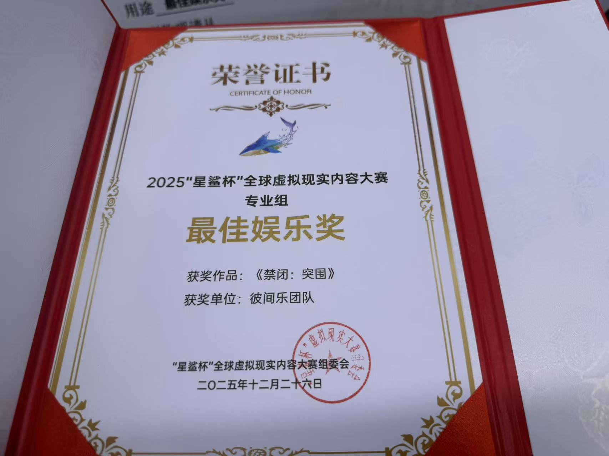
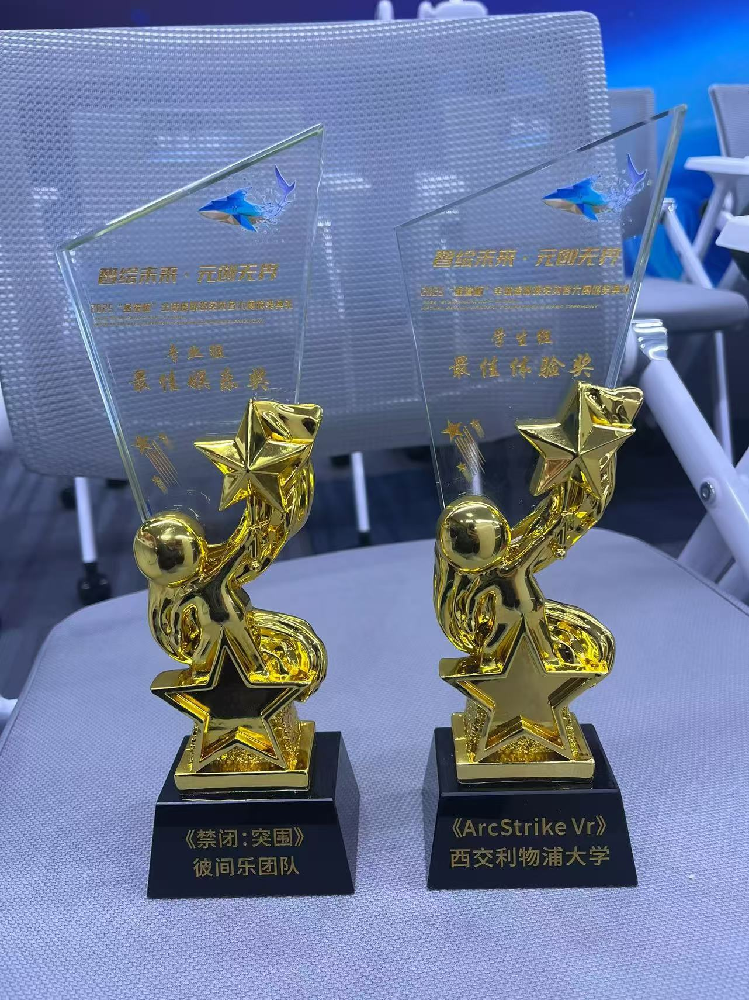

# Lockdown: Breakout

**An award-winning VR horror escape game built with Unity and OpenXR.**

*Chinese title: 禁闭：突围*

Lockdown: Breakout places you inside a biological research facility controlled by a rogue scientist. After a containment failure, hostile experimental creatures roam the building. Search for keys, solve environmental puzzles, operate doors and switches, and evade pursuing enemies to find a way out.

The project was created by **Team XJTLU Joy Over There (西浦彼间乐)** with support from the Virtual Engineering Centre at Xi'an Jiaotong-Liverpool University. Its design combines controller-driven virtual hands, interactive escape puzzles, and custom NavMesh enemy behavior to create a tense, embodied VR experience.

This repository shares the original gameplay code and selected project configuration under the MIT License. Third-party art, audio, fonts, asset packs, and the full demo level are excluded and must be obtained separately. See [Third-party assets and release scope](THIRD_PARTY.md). This source release requires asset integration before the complete game can be played.

## Award

**Best Entertainment Award, Professional Category, 2025 Star Shark Cup Global VR Content Competition**

Awarded to **Lockdown: Breakout (禁闭：突围)** and **Team XJTLU Joy Over There**.

<table>
  <tr>
    <td align="center"></td>
    <td align="center"></td>
  </tr>
  <tr>
    <td align="center">Best Entertainment Award certificate</td>
    <td align="center">Lockdown: Breakout trophy on the left; the trophy on the right belongs to a separate project.</td>
  </tr>
</table>

## Gameplay

- **VR interaction:** animated virtual hands and controller input for grabbing objects and operating interactive elements.
- **Escape puzzles:** keys, locked doors, switches, and environmental triggers that support progression through the facility.
- **Enemy behavior:** custom NavMesh patrol and pursuit logic, including several creature behaviors.
- **Survival systems:** safe zones, death and restart handling, and an escape condition.
- **Environmental storytelling:** contrasting residential and laboratory spaces establish the setting of the original game.

The released scripts include door and key interactions, switch puzzle management, enemy AI, safe zones, player handling, and game state logic. The original game's visual environments depend on external assets that are not included here.

## Technology

| Component | Version recorded in the project |
| --- | --- |
| Unity Editor | 2022.3.62f2 |
| OpenXR Plugin | 1.14.3 |
| XR Interaction Toolkit | 2.6.4 |
| XR Hands | 1.4.3 |
| AI Navigation | 1.1.7 |
| Universal Render Pipeline | 16.0.6 |

**VR / OpenXR:** the saved XR configuration uses the OpenXR loader for the Standalone target. Use an OpenXR-capable headset and an active OpenXR runtime for PC VR testing. Meta Quest 3 was the target headset described in the original project materials; this checkout does not provide a validated standalone Android/Quest build.

## Getting started

1. Clone the repository or download its source archive:

   ```bash
   git clone https://github.com/painfulmoments/lockdown_breakout.git
   ```

2. Add the cloned folder to Unity Hub and open it with **Unity 2022.3.62f2**. Allow Unity to restore the packages listed in `Packages/manifest.json`.
3. In **Window > Package Manager > XR Interaction Toolkit 2.6.4 > Samples**, import **Starter Assets**. The gameplay scripts reference that sample's namespace, so it is required for compilation. Review [THIRD_PARTY.md](THIRD_PARTY.md), obtain other assets you need from their original publishers, and import them under their own licenses. Import TextMesh Pro resources through its package tools when needed.
4. Create a new scene and integrate the gameplay scripts and selected prefabs. Some saved prefabs reference omitted models, scripts, or Unity package samples and need their references restored or replaced. `Assets/Scenes/SampleScene.unity` contains only legacy scene settings with omitted lighting and skybox references. `Assets/GameStart.unity` preserves a menu layout whose script, image, and font dependencies also need restoration. Neither is a playable escape level.
5. In **Project Settings > XR Plug-in Management**, review the Standalone OpenXR provider and enable **Initialize XR on Startup** as needed. The saved project's automatic XR initialization flags are disabled.
6. Select your headset's active OpenXR runtime, resolve the required asset and package references, and add your integrated scene to Build Settings before entering Play Mode or making a build.

The original Build Settings reference `Assets/QA_HoldingCells/Demo/Demo_2.unity`. That level is inside an excluded third-party asset pack and is not distributed in this repository.

**Import and build status:** the original version records are preserved. The manifest lists URP 16.0.6 alongside Unity 2022.3.62f2, so package compatibility needs to be checked during import. This publication has not been validated with a Unity build or a headset playtest.

## Team

**Team XJTLU Joy Over There (西浦彼间乐)** brings together programming, environment art, and interaction design at Xi'an Jiaotong-Liverpool University's Virtual Engineering Centre.

| Contributor | Role |
| --- | --- |
| Binwei Lei (雷滨玮) | Technical lead, core gameplay and enemy AI, testing and optimization |
| Yibang Zhao (赵翊邦) | Art lead, environment planning and scene construction |
| Zeren Tao (陶择仁) | Experience design, level flow, puzzles and interaction design |
| Qilei Sun (孙齐蕾) | Academic guidance |

## License

The team's original code and authored gameplay configuration included in this repository are available under the [MIT License](LICENSE).

Unity packages and Unity sample-derived portions of the saved XR scaffolding retain their respective licenses, including the [XR Interaction Toolkit license notice](docs/licenses/Unity-XR-Interaction-Toolkit-LICENSE.md). Separately imported third-party assets retain their original licenses. Award photos are included as documentation of the achievement and are excluded from the software license. See [THIRD_PARTY.md](THIRD_PARTY.md) for the release boundaries.
