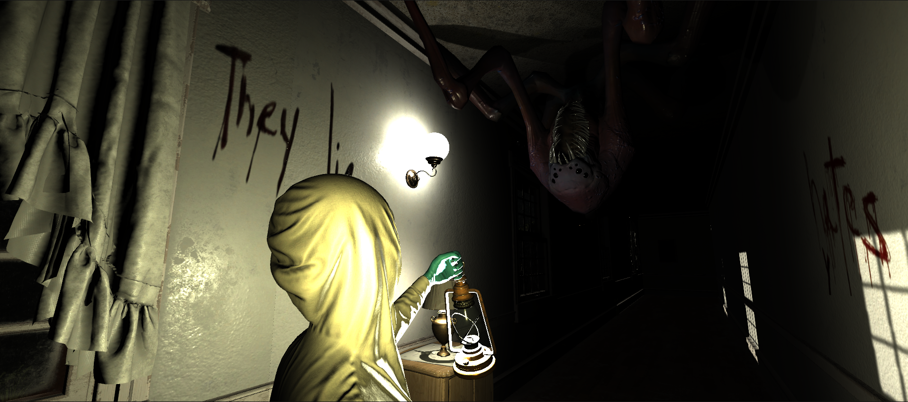
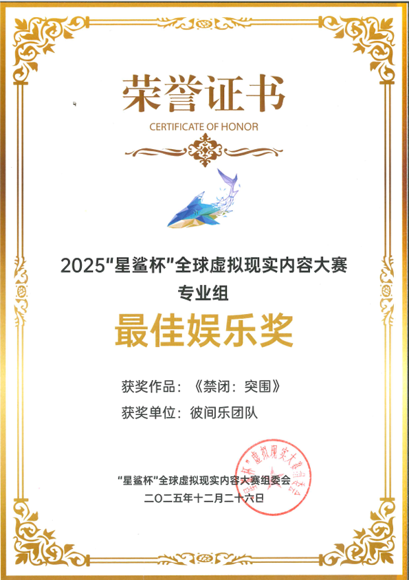
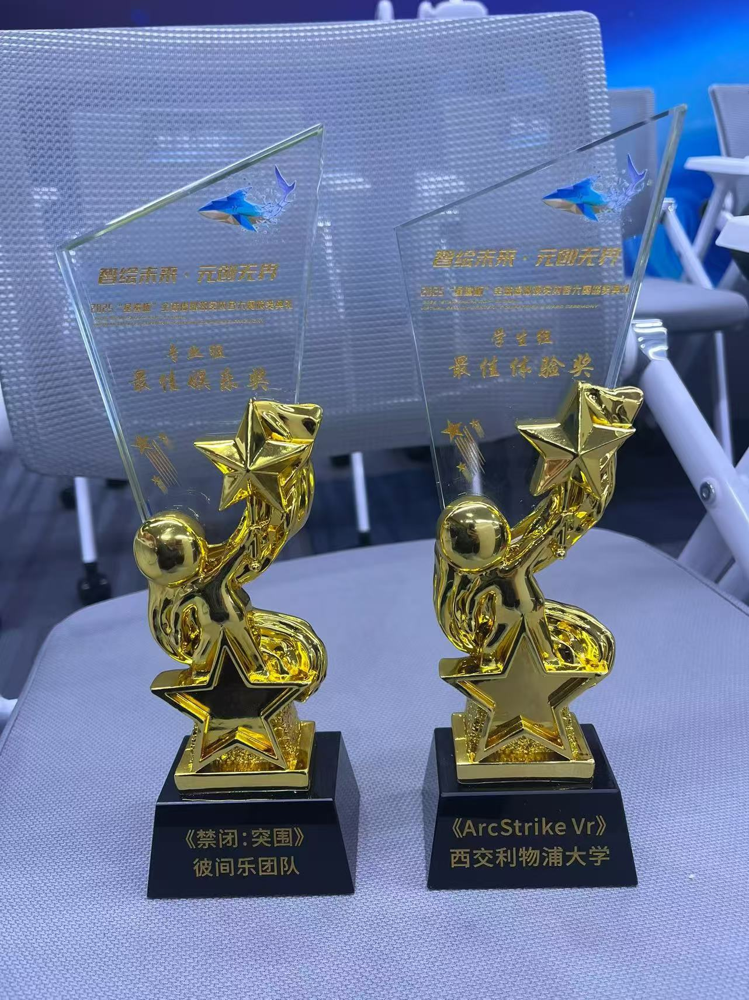

# Lockdown：Breakout

**A VR horror escape game developed from an experimental research prototype.**



**Unity · Windows PC VR / OpenXR · 3-person game team · 2025**

[Downloads](https://github.com/painfulmoments/lockdown_breakout/releases) · [Play guide](PLAYING.md) · [Project case study](https://14mountain.com/engineering-lockdown) · [Research paper](https://doi.org/10.1016/j.cag.2025.104470)

You are trapped in a biological research facility after a containment failure. Find a route through its two floors, solve environmental puzzles and avoid the creatures moving through the building. Controller-driven hands let you handle objects and operate the environment; a laser weapon can slow enemies when you need a way past them.

*Chinese title: 禁闭：突围. Created by Team XJTLU Joy Over There (西浦彼间乐), with support from the Virtual Engineering Centre at Xi’an Jiaotong-Liverpool University.*

## Play the demo

**A VR headset and tracked controllers are required.** The desktop build runs on a Windows PC and sends the VR view to a connected headset. It is not an Android APK or a headset-only Quest installation.

Download the [Windows x64 PC VR demo — v0.1.0](https://github.com/painfulmoments/lockdown_breakout/releases/tag/v0.1.0-pcvr). Download **all numbered ZIP parts** and **`Join_Demo.cmd`** into the same folder. Double-click the helper to combine the archive, then use Windows **Extract All**. No extra extraction software is needed.

The release is a public prototype preview. The Windows player was built with Unity 2022.3.62f2; the [build and validation record](docs/BUILD_AND_VALIDATION.md) distinguishes build checks from physical-headset testing.

For Quest, the launch sequence is: **connect to the PC → enter Quest Link → run the extracted game `.exe`**. Read the [complete play guide](PLAYING.md) for the OpenXR setup, controls and troubleshooting. Players do not need Unity or Git LFS to run a packaged demo.

## Gameplay

| System | What it adds to the escape |
| --- | --- |
| Two-floor progression | Move between the lower containment spaces and the contrasting domestic rooms above. Objectives, enemy routes and button locations connect the two floors. |
| Environmental puzzles | Search for keys, operate doors and activate switches to open the way forward. The adopted button puzzle was developed collaboratively. |
| Patrol and pursuit | NavMesh-based enemies patrol, detect and chase the player. Hiding spaces and checkpoints provide ways to respond to encounters. |
| Slowing laser weapon | Use a controller-held weapon to reduce an enemy’s movement speed. It was added to make the competition demo more approachable for players less familiar with horror games. |
| Weapon recovery route | A hole back to the basement gives players another opportunity to discover a gun they may have passed earlier, then return using an already-open route. |
| Embodied interaction | Quest controller inputs animate simulated hands and drive object and environmental interaction. |

The game is a **core gameplay prototype**.

## From research prototype to escape game

Lockdown grew from **SURF 2024**, a Unity VR horror research project. The research prototype separated a shared environment into three conditions: Scene 0 (atmospheric), Scene 1 (monster-chase), and Scene 2 (baseline). A 30-participant study compared physiological recordings and subjective responses, leading to a paper published in 2025.

For Lockdown, the game team brought the previously separated elements into a connected escape experience. The focus shifted from controlling experimental stimuli to arranging progression, encounters, puzzles and player responses across two floors.

**Publication:** Tao, Z., et al. (2025). *Correlations between instant and prolonged stimuli with physiological and subjective responses in VR horror*. Computers & Graphics, 133, 104470. [DOI: 10.1016/j.cag.2025.104470](https://doi.org/10.1016/j.cag.2025.104470).

## Award

**Best Entertainment Award · Professional Category**  
2025 Star Shark Cup Global Virtual Reality Content Competition

Awarded to **Lockdown：Breakout (禁闭：突围)** and **Team XJTLU Joy Over There**. The certificate is dated **26 December 2025**.

<table>
  <tr>
    <td align="center"></td>
    <td align="center"></td>
  </tr>
  <tr>
    <td align="center">Best Entertainment Award certificate</td>
    <td align="center">Lockdown trophy on the left. The trophy on the right belongs to a separate project.</td>
  </tr>
</table>

## Game team

| Contributor | Responsibilities |
| --- | --- |
| **Binwei Lei — Game Designer & Lead Developer** | Led most mechanics and level design, including chase routes, spawn and respawn points, two-floor progression and button placement. Wrote the main gameplay code and integrated the team’s systems. Proposed the slowing laser weapon and weapon-recovery route, and the original spotlight puzzle concept. |
| **Zeren Tao — Co-design & Programming** | Contributed to planning and programming, including decisions about monsters, the guard character’s appearance and weapon mechanics. Proposed and developed the adopted four-button puzzle. |
| **Yibang Zhao — Environment Art & Scene Building** | Created map art, assembled scenes, and produced and integrated art assets. |

Specific puzzle ideas were discussed together. **Qilei Sun** provided academic guidance. The SURF research stage involved a separate seven-member research team; its authorship and research credits are recorded in the paper.

## Open the Unity project

The repository contains the gameplay scripts, the main escape scene and the selected assets and interaction dependencies needed by that scene. Large binary assets use **Git LFS**.

```bash
git lfs install
git clone https://github.com/painfulmoments/lockdown_breakout.git
cd lockdown_breakout
git lfs pull
```

The selected source content occupies approximately **8.3 GiB** before Unity generates its `Library` folder. Allow additional space for imports, packages and builds. A GitHub source ZIP containing LFS pointer files is not a substitute for the complete asset checkout.

1. Add the cloned folder to Unity Hub and open it with **Unity 2022.3.62f2**.
2. Allow package restoration and asset import to complete.
3. Open **`Assets/QA_HoldingCells/Demo/Demo_2.unity`**, the main escape level selected in Build Settings. A fresh Editor session opens this scene automatically when there is no saved scene.
4. Connect the headset and select an active OpenXR runtime. The saved Standalone configuration uses the OpenXR loader with **Initialize XR on Startup** enabled.
5. Enter Play Mode to test in the Editor, or build the enabled main scene for Windows Standalone.

| Component | Recorded version |
| --- | --- |
| Unity Editor | 2022.3.62f2 |
| OpenXR Plugin | 1.14.3 |
| XR Interaction Toolkit | 2.6.4 |
| XR Hands package | 1.4.3 |
| AI Navigation | 1.1.7 |
| Universal Render Pipeline | 14.0.12 |

Meta Quest 3 was the project’s target headset. An Android/standalone Quest build has not been validated for this repository.

## Validation

The Windows x64 player now builds successfully and has completed a short desktop startup check. **A connected-headset playthrough has not been performed.** See the [current build record](docs/BUILD_AND_VALIDATION.md) for results and the OpenXR behavior observed without a headset.

The existing clean-source check restored packages, imported the selected assets, compiled scripts and opened the main level in Unity 2022.3.62f2. Its approximately 20-second automated Play Mode run reported zero errors and no missing scene scripts. Interaction checks covered eight saved switch positions, an open cabinet door retaining its rotation, and escape feedback. Those checks called gameplay methods; they did not simulate a complete controller-driven escape playthrough.

Some imported collider warnings remain. See the release notes for packaged-build checks, [validation details](docs/VALIDATION.md) for the source checks, and the [asset manifest](docs/ASSET_MANIFEST.txt) for the selected content.

## License and included assets

The team’s original code and authored gameplay configuration included in this repository use the [MIT License](LICENSE).

Included third-party assets are published based on redistribution permissions confirmed by the project owner and retain their original terms and notices. The MIT License does not relicense them. Unity packages and Unity sample-derived portions retain their respective licenses; notices are preserved in [docs/licenses](docs/licenses), including the [Unity Companion License](docs/licenses/Unity-Companion-License.md). Liberation Sans retains the SIL Open Font License. Award photos document the achievement and are excluded from the software license. See [third-party assets and release scope](THIRD_PARTY.md).
