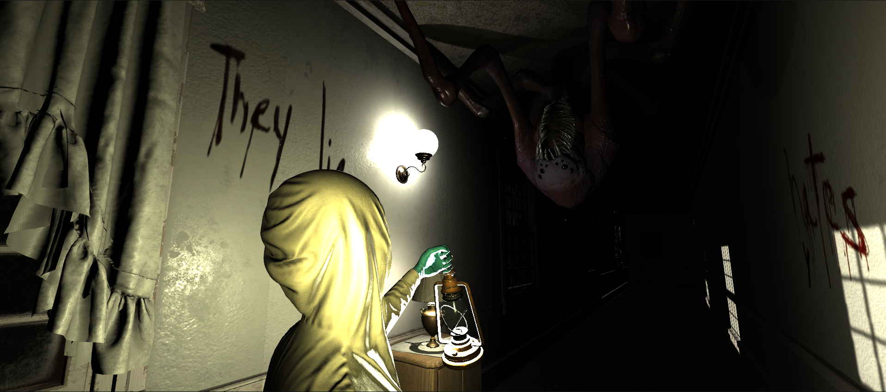
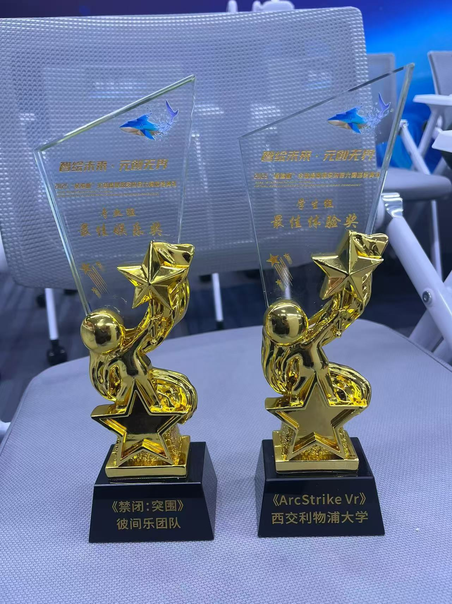

# Lockdown：Breakout · 禁闭：突围

**从实验研究原型发展而来的 VR 恐怖逃脱游戏。**

**Unity · Windows PC VR / OpenXR · 3 人游戏团队 · 2025**

[PC VR 试玩下载](https://github.com/painfulmoments/lockdown_breakout/releases/tag/v0.1.0-pcvr) · [PC VR 中文试玩说明](PLAYING.zh-CN.md) · [旧版 SURF 试玩](SURF_PC_DEMO.zh-CN.md) · [English](README.md) · [项目案例](https://14mountain.com/engineering-lockdown) · [研究论文](https://doi.org/10.1016/j.cag.2025.104470)



**版本状态：** Windows PC VR 预览版。构建和桌面启动检查已通过，完整打包版头显试玩仍待验证。[构建与验证记录](docs/BUILD_AND_VALIDATION.md)。

你被困在发生收容事故的生物研究设施中，需要在上下两层空间寻找路线、解决环境谜题，并避开游荡和追逐你的生物。手柄驱动的虚拟手支持物品与环境交互；手持激光武器可以减缓敌人速度，为逃脱争取机会。

项目由 **Team XJTLU Joy Over There（西浦彼间乐）**创作，获得西交利物浦大学 Virtual Engineering Centre 支持。

## 项目速览

| 项目 | 当前范围 |
| --- | --- |
| 引擎 | Unity 2022.3.62f2 |
| 运行平台 | Windows x64 PC VR / OpenXR |
| 目标设备 | Meta Quest 3 与两个跟踪手柄 |
| 当前试玩 | [v0.1.0-pcvr 预览版](https://github.com/painfulmoments/lockdown_breakout/releases/tag/v0.1.0-pcvr) |
| Quest 运行方式 | 游戏运行在电脑上，通过 Quest Link 进入头显；不提供独立 Quest APK |
| 验证状态 | Windows 构建与短时桌面启动已通过；本包尚未完成连接头显后的全流程试玩 |
| 游戏团队 | 3 人，2025 年 |

其他 OpenXR 头显、有线 Link 与无线 Link 在本包中的物理头显体验尚未完成验证。完整范围见[构建与验证记录](docs/BUILD_AND_VALIDATION.md)。

## 选择试玩版本

| 版本 | 运行包 | 下载与说明 |
| --- | --- | --- |
| **当前 Lockdown：Breakout** | Windows PC VR / OpenXR 预览版 | [v0.1.0-pcvr 发布页](https://github.com/painfulmoments/lockdown_breakout/releases/tag/v0.1.0-pcvr) · [PC VR 中文试玩说明](PLAYING.zh-CN.md) |
| **旧版 SURF 2024** | 历史 Windows 键鼠桌面构建；**1.96 GiB**，单个 ZIP | [旧版可运行包发布页](https://github.com/painfulmoments/lockdown_breakout/releases/tag/surf2024-legacy-pc-playable-2026-11-19) · [旧版中文试玩说明](SURF_PC_DEMO.zh-CN.md) |
| SURF 2024 演示录屏 | 1080p 视频；**仅录屏，不是可运行游戏** | [观看／下载录屏](https://github.com/painfulmoments/lockdown_breakout/releases/tag/surf2024-pc-demo-2026-11-18) |

旧版发布保留原始 SURF 桌面归档，其中包含 `escape the villa/escape the villa.exe` 及配套运行文件。这是历史二进制包，**不是从本仓库当前 Unity 源项目构建的版本**。其操作要求和验证范围单独记录在[旧版试玩说明](SURF_PC_DEMO.zh-CN.md)中。下方奖项属于 Lockdown：Breakout。

## 下载与启动

以下步骤和操作表适用于**当前 Lockdown PC VR 预览版**。历史 SURF 桌面包请使用[旧版中文试玩说明](SURF_PC_DEMO.zh-CN.md)。

**需要 VR 头显、两个跟踪手柄和可运行 PC VR 的 Windows 电脑。试玩无需安装 Unity Editor、Git 或 Git LFS。**

| 文件 | 大小／用途 |
| --- | --- |
| [ZIP 分片 .001](https://github.com/painfulmoments/lockdown_breakout/releases/download/v0.1.0-pcvr/LockdownBreakOut-Windows-x64-v0.1.0.zip.001) | **1.50 GiB**，必需 |
| [ZIP 分片 .002](https://github.com/painfulmoments/lockdown_breakout/releases/download/v0.1.0-pcvr/LockdownBreakOut-Windows-x64-v0.1.0.zip.002) | **0.97 GiB**，必需 |
| [Join_Demo.cmd](https://github.com/painfulmoments/lockdown_breakout/releases/download/v0.1.0-pcvr/Join_Demo.cmd) | 校验并拼接两个分片 |
| [SHA256SUMS.txt](https://github.com/painfulmoments/lockdown_breakout/releases/download/v0.1.0-pcvr/SHA256SUMS.txt) | 可选，手动完整性检查 |

1. 将上表的 **两个分片和拼接助手**下载到同一文件夹。
2. 建议同时保存同版本的 `SHA256SUMS.txt`，用于核对下载文件。双击 **`Join_Demo.cmd`**，由它校验分片并拼接完整 ZIP，再核对完整 ZIP 的 SHA-256；已有 ZIP 也须通过校验，不会仅因文件存在就判为成功。
3. 对生成的 `LockdownBreakOut-Windows-x64-v0.1.0.zip` 使用 Windows **“全部解压缩 / Extract All”**。不需要额外安装解压软件。保留下载分片、完整 ZIP 和解压后的游戏时，请准备约 **20 GB 空闲空间**。
4. 连接 Quest，打开电脑端 **Meta Horizon Link / Meta Quest Link**，将其设为当前活动的 **OpenXR Runtime**，并在头显内进入 **Quest Link**。
5. 在解压后的 `LockdownBreakOut-Windows-x64` 文件夹内双击 **`LockdownBreakOut.exe`**。保留同目录的 `_Data` 文件夹、`UnityPlayer.dll` 及其他随包文件。

**这两个文件是一个 ZIP 的编号分片，必须先拼接再解压。不要分别解压 `.001` 和 `.002`，也不要选择 GitHub 自动生成的 “Source code” 归档来试玩。**

首次连接、操作与故障排查见[中文试玩说明](PLAYING.zh-CN.md)。启动顺序是：**连接电脑 → 设置活动 OpenXR Runtime → 在头显内进入 Link → 启动游戏 EXE**。

## 手柄操作

| 操作 | 功能 |
| --- | --- |
| 转动头部 | 观察环境，视角跟随头显跟踪 |
| 左摇杆 | 移动 |
| 右摇杆 | 连续转向 |
| 握持键 / Grip / Select | 拾取支持交互的物品，操作谜题开关 |
| 扳机 / Trigger / Activate | 使用已拿起的减速武器；在范围内操作钥匙控制的门 |
| 关闭电脑游戏窗口 / Alt+F4 | 退出 |

以上操作基于当前输入动作与游戏脚本核对；完整手柄实测仍待完成。

## 游戏机制

| 系统 | 对逃脱体验的作用 |
| --- | --- |
| 双层空间推进 | 在下层收容空间与上层生活区域之间探索，目标、敌人路线与按钮位置连接两层空间。 |
| 环境谜题 | 寻找钥匙、操作门和开关以打开路线；最终采用的按钮谜题由团队共同讨论与开发。 |
| 巡逻与追逐 | 基于 NavMesh 的敌人会巡逻、发现并追逐玩家，藏身点与检查点提供应对方式。 |
| 减速激光武器 | 手柄持枪可以降低敌人移动速度；该机制用于让竞赛演示更适合不熟悉恐怖游戏的玩家。 |
| 武器补取路线 | 返回地下层的洞口让错过武器的玩家获得再次发现它的机会，再沿已打开的路线返回。 |
| 身体化交互 | Quest 手柄输入驱动虚拟手动画及物品、环境交互。 |

当前版本是**核心玩法原型**。

## 从研究原型到逃脱游戏

Lockdown 源于 **SURF 2024** Unity VR 恐怖研究项目。研究原型将共同环境分成三个条件：Scene 0（环境氛围）、Scene 1（怪物追逐）和 Scene 2（基线）。研究比较了 30 名参与者的生理记录与主观反馈，相关论文于 2025 年发表。

在 Lockdown 阶段，游戏团队将此前分开的要素组织成连续的逃脱体验，工作重点从控制实验刺激，转向上下两层空间中的推进、遭遇、谜题和玩家应对。

**论文：** Tao, Z., et al. (2025). *Correlations between instant and prolonged stimuli with physiological and subjective responses in VR horror*. Computers & Graphics, 133, 104470。[DOI](https://doi.org/10.1016/j.cag.2025.104470)。

## 奖项

**最佳娱乐奖 · 专业组（Best Entertainment Award · Professional Category）**
2025 Star Shark Cup Global Virtual Reality Content Competition

获奖项目为 **Lockdown：Breakout（禁闭：突围）**，团队为 **Team XJTLU Joy Over There**。证书日期为 **2025 年 12 月 26 日**。

<table>
  <tr>
    <td align="center"></td>
    <td align="center"></td>
  </tr>
  <tr>
    <td align="center">最佳娱乐奖证书</td>
    <td align="center">左侧为本项目奖杯，右侧奖杯属于另一个项目。</td>
  </tr>
</table>

## 游戏团队

| 成员 | 职责 |
| --- | --- |
| **Binwei Lei — 游戏设计与主程序** | 主导大部分机制与关卡设计，包括追逐路线、出生与重生点、双层推进和按钮位置；编写主要玩法代码并整合团队系统；提出减速激光武器、武器补取路线及最初的聚光灯谜题概念。 |
| **Zeren Tao — 共同设计与程序** | 参与策划和编程，包括怪物、守卫角色外观与武器机制相关决策；提出并开发最终采用的四按钮谜题。 |
| **Yibang Zhao — 环境美术与场景搭建** | 负责地图美术、场景搭建，以及美术资源的制作与整合。 |

具体谜题方案由团队共同讨论。**Qilei Sun** 提供学术指导。SURF 研究阶段由另一支七人研究团队参与，其作者与研究贡献以论文记录为准。

## 打开 Unity 源项目

仓库包含玩法脚本、主逃脱场景，以及该场景所需的选定资源和交互依赖。大型二进制源资源使用 **Git LFS**。

```bash
git lfs install
git clone https://github.com/painfulmoments/lockdown_breakout.git
cd lockdown_breakout
git lfs pull
```

选定源文件约占 **8.3 GiB**，尚未计入 Unity 生成的 `Library`、导入缓存、包和构建产物。包含 LFS 指针的 GitHub 源码 ZIP 不能替代完整资源检出。

1. 在 Unity Hub 中添加克隆的文件夹，以 **Unity 2022.3.62f2** 打开。
2. 等待包恢复和资源导入完成。
3. 打开 **`Assets/QA_HoldingCells/Demo/Demo_2.unity`**，这是 Build Settings 中启用的主关卡。没有已保存场景状态的新编辑器会话会自动打开它。
4. 连接头显并选择活动 OpenXR Runtime。保存的 Standalone 设置使用 OpenXR Loader，已启用 **Initialize XR on Startup**。
5. 在编辑器中进入 Play Mode，或将主场景构建为 Windows Standalone。

| 组件 | 记录版本 |
| --- | --- |
| Unity Editor | 2022.3.62f2 |
| OpenXR Plugin | 1.14.3 |
| XR Interaction Toolkit | 2.6.4 |
| XR Hands | 1.4.3 |
| AI Navigation | 1.1.7 |
| Universal Render Pipeline | 14.0.12 |

Windows 构建和短时桌面启动已通过；历史清洁源项目检查通过了包恢复、导入、编译、场景加载及部分自动交互断言。**这些结果不等于完整的头显逃脱试玩。** 详细依据见[构建记录](docs/BUILD_AND_VALIDATION.md)、[源项目验证](docs/VALIDATION.md)及[资源清单](docs/ASSET_MANIFEST.txt)。部分导入碰撞体警告仍存在。

## 许可与第三方资源

团队在本仓库中的原创代码和自有玩法配置采用 [MIT License](LICENSE)。第三方资源按项目所有者确认的再分发范围收录，版权与原有条款保持不变，**MIT 不会重新授权这些资源**。

Unity 包和示例派生内容保留各自许可证，相关原文位于 [docs/licenses](docs/licenses)，包含 [Unity Companion License](docs/licenses/Unity-Companion-License.md)。Liberation Sans 保留 SIL Open Font License。奖项照片用于记录项目成果，不属于 MIT 软件许可范围。完整说明见[第三方资源与发布范围](THIRD_PARTY.md)。

## 相关项目

[REHUB / Grounding Demo](https://github.com/painfulmoments/Grounding_demo) 是另一个 Windows PC VR 项目，在森林瀑布场景中提供数字人引导的着陆练习。其下载包和启动步骤与本游戏不同，请使用对应仓库的试玩说明。
